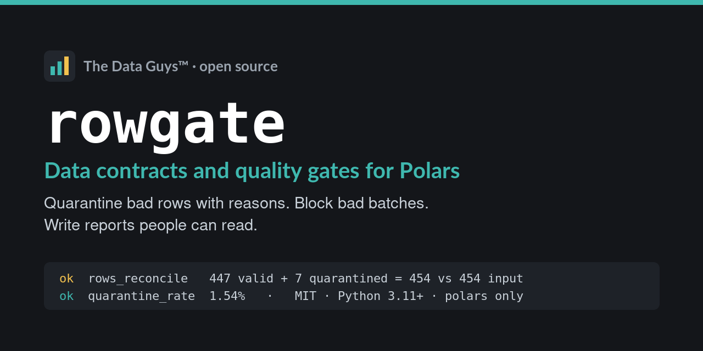

<div align="center">



# rowgate

**Data contracts and quality gates for [Polars](https://pola.rs). Quarantine bad rows with reasons, block bad batches, and write reports people can read.**

[](https://github.com/DTheDataGuy/rowgate/actions/workflows/ci.yml)
[](https://github.com/DTheDataGuy/rowgate/releases)


[](LICENSE)
[](https://github.com/DTheDataGuy/rowgate/stargazers)

[Install](#install) · [Quick start](#quick-start) · [Why rowgate](#why-rowgate) · [Real data](#on-real-data) · [Contracts](#contracts) · [Checks](#checks) · [CI and orchestrators](#use-it-in-ci-and-orchestrators) · [CLI](#command-line) · [Contributing](CONTRIBUTING.md)

</div>

rowgate does two jobs that most pipelines need and usually hand-roll:

1. **Split** a batch into rows that meet the contract and rows that don't. Rejected rows go to a quarantine frame that lists every rule each row broke. Nothing is silently dropped, and `valid + quarantined = input` always holds.
2. **Gate** the batch with dataset-level checks (schema drift, uniqueness, null rates, freshness, reconciliation). `error` checks block the load, `warn` checks are reported. The result is a report you can log as JSON, attach to a run as Markdown or print to a terminal.

The only dependency is Polars.

## Why rowgate

Most validation tools answer one question: did this DataFrame pass? Production pipelines need three more answers. Which rows failed, why did each one fail, and is it safe to load the rest? rowgate is built around those questions.

| You need to | rowgate gives you |
|---|---|
| Keep loading good rows when a few are bad | `contract.split(df)` returns `valid` and `quarantine` frames, and proves they add up to the input |
| Fix source data in one pass | Every broken rule is listed per row, not just the first one |
| Stop a bad batch before it reaches the warehouse | `Gate(...).run(df).raise_for_errors()` or a CLI exit code of `1` |
| Tell on-call what happened | Readable observed values such as "3 duplicate keys" or "9.62% null" |
| Keep rules next to the pipeline | Contracts in Python or TOML, with row rules in SQL or Polars expressions |
| Stay light | One dependency (Polars), typed, single-pass expression evaluation |

## Install

```bash
pip install git+https://github.com/DTheDataGuy/rowgate@v0.1.0
```

## Quick start

```python
import polars as pl
import rowgate as rg
from rowgate import checks as ck

orders = pl.DataFrame({
    "order_id": [1001, 1002, 1002, 1004, 1005],
    "customer": ["acme", "globex", "globex", None, "initech"],
    "amount":   [250.0, 99.5, 99.5, -20.0, 1_200.0],
    "currency": ["USD", "USD", "USD", "USD", "usd"],
})

contract = rg.Contract(columns={
    "order_id": rg.Column(pl.Int64, required=True, unique=True),
    "customer": rg.Column(pl.Utf8, required=True),
    "amount":   rg.Column(pl.Float64, min=0),
    "currency": rg.Column(pl.Utf8, accepted=["USD", "EUR", "GBP"]),
})

result = contract.split(orders)
result.quarantine
```

```text
┌──────────┬──────────┬────────┬──────────┬───────────────────────────────────────┐
│ order_id ┆ customer ┆ amount ┆ currency ┆ _rowgate_reasons                      │
╞══════════╪══════════╪════════╪══════════╪═══════════════════════════════════════╡
│ 1002     ┆ globex   ┆ 99.5   ┆ USD      ┆ ["order_id:duplicate"]                │
│ 1004     ┆ null     ┆ -20.0  ┆ USD      ┆ ["customer:required", "amount:min"]   │
│ 1005     ┆ initech  ┆ 1200.0 ┆ usd      ┆ ["currency:accepted"]                 │
└──────────┴──────────┴────────┴──────────┴───────────────────────────────────────┘
```

The first `1002` is kept and the repeat is quarantined. Row `1004` broke two rules, and both are listed.

```python
report = rg.Gate([
    ck.schema_matches(contract),
    ck.reconciles(result),
    ck.quarantine_rate(result, max_pct=10),
    ck.row_count(min_rows=1),
]).run(result.valid)

print(report)
report.raise_for_errors()   # raises rowgate.GateFailed in a pipeline
```

```text
rowgate: FAIL (2 rows)
  ok    schema_matches   no drift
  ok    rows_reconcile   2 valid + 3 quarantined = 5 vs 5 input
  FAIL  quarantine_rate  60.0%
  ok    row_count        2 rows
```

## On real data

[`examples/seattle_permits.py`](examples/seattle_permits.py) runs a contract over a 454-row sample of the City of Seattle's public [Building Permits](https://data.seattle.gov/Built-Environment/Building-Permits/76t5-zqzr) dataset:

```text
rowgate: PASS (447 rows)
  ok    schema_matches                    no drift
  ok    rows_reconcile                    447 valid + 7 quarantined = 454 vs 454 input
  ok    quarantine_rate                   1.54%
  ok    unique:permit_num                 0 duplicate keys
  ok    not_null:permit_num+permit_class  0 nulls
  ok    null_rate:applied_date            9.62% null
  ok    null_rate:zip                     4.7% null
  warn  freshness:applied_date            newest 2026-07-02 (110 days old)
```

```text
reason                       rows
issued_on_or_after_applied      3
permit_num:pattern              3
est_cost:max                    1
```

The 7 quarantined rows are real problems in the source data:

- 3 permits were issued before they were applied for.
- 3 sub-permit numbers like `6112685-EX-002` don't match the documented format.
- 1 permit lists an estimated cost of $25,000,000,000.

If sub-permits are valid for your use, widen the pattern in [`permits_contract.toml`](examples/permits_contract.toml). The freshness warning is expected, because the sample is a fixed extract.

The same approach runs at full scale in the [Seattle Permits Data Platform](https://github.com/DTheDataGuy/the-data-guys-portfolio/tree/main/data-engineering): 193,747 rows through a Polars pipeline, dbt, PySpark and Scala Spark.

## Contracts

### Columns

| Option | Meaning | Nulls |
|---|---|---|
| `dtype` | Expected Polars dtype, checked by `schema_matches` | n/a |
| `required` | Value must be present. Blank strings count as missing | fail |
| `unique` | First occurrence kept; later duplicates quarantined | skipped |
| `accepted` | Value must be in the list | skipped |
| `min`, `max` | Inclusive bounds | skipped |
| `pattern` | Regex the value must match | skipped |

Nulls only fail `required`, the same way SQL constraints behave. Set `allow_extra_columns=False` to treat unexpected columns as schema drift.

### Rules

Row-level rules are Polars expressions that are true for valid rows:

```python
rg.Rule("issued_on_or_after_applied", pl.col("issued_date") >= pl.col("applied_date"))
```

A rule that evaluates to null passes, so a permit that hasn't been issued yet isn't rejected by an ordering rule.

### TOML

Contracts can live next to the pipeline as config, with rules written in SQL:

```toml
[columns.permit_num]
dtype = "str"
required = true
unique = true
pattern = '^\d{6,7}-[A-Z]{2}$'

[columns.est_cost]
dtype = "float"
min = 0
max = 5_000_000_000

[[rules]]
name = "issued_on_or_after_applied"
sql = "issued_date >= applied_date"
```

```python
contract = rg.Contract.from_toml("permits_contract.toml")
```

## Checks

| Check | Default severity | Passes when |
|---|---|---|
| `schema_matches(contract)` | error | Every contract column is present with the right dtype |
| `unique(cols)` | error | No duplicate keys (one column or a composite) |
| `not_null(cols)` | error | No nulls in the listed columns |
| `null_rate(col, max_pct)` | warn | Null share is at or below the limit |
| `accepted_values(col, values)` | error | No values outside the set |
| `row_count(min_rows, max_rows)` | error | Row count is within bounds |
| `reconciles(result)` | error | Valid + quarantined equals input |
| `quarantine_rate(result, max_pct)` | error | Quarantined share is below the limit |
| `freshness(col, max_age_days, as_of)` | warn | Newest date is recent enough |
| `expr(name, condition, max_failing)` | error | At most `max_failing` rows break the condition |
| `custom(name, fn, expectation)` | error | `fn(df)` returns `(True, observed)` |

Every check takes `severity="error"` or `severity="warn"`. If a check itself raises, for example because a column is missing, it's recorded as a failure with the exception message, and the other checks still run.

## Reports

```python
report.passed          # False if any error check failed
report.errors          # failed error checks
report.warnings        # failed warn checks
report.to_json("quality_report.json")
report.to_markdown("quality_report.md")
```

The Markdown output is a table that renders in GitHub, GitLab and most CI summaries:

| Check | Severity | Result | Observed | Expectation |
|---|---|---|---|---|
| `rows_reconcile` | error | pass | 2 valid + 3 quarantined = 5 vs 5 input | valid + quarantined = input |
| `quarantine_rate` | error | **FAIL** | 60.0% | < 10% of input quarantined |

## Use it in CI and orchestrators

GitHub Actions, failing the job and posting the report to the run summary:

```yaml
- run: pip install git+https://github.com/DTheDataGuy/rowgate@v0.1.0
- run: rowgate check data/orders.parquet --contract contracts/orders.toml --report-dir out/
- if: always()
  run: cat out/report.md >> "$GITHUB_STEP_SUMMARY"
```

Inside an Airflow, Dagster or Prefect task, or any Python job:

```python
result = contract.split(df)
result.quarantine.write_parquet("quarantine/orders.parquet")   # keep the evidence
rg.Gate([ck.reconciles(result), ck.quarantine_rate(result, max_pct=2)]).run(result.valid).raise_for_errors()
result.valid.write_parquet("silver/orders.parquet")            # only reached when the gate passes
```

## Command line

```bash
rowgate check orders.parquet --contract contract.toml --report-dir out/
```

The command reads Parquet, CSV, NDJSON or JSON files. It prints the report and a count of quarantine reasons. With `--report-dir` it also writes `report.json`, `report.md` and `quarantine.parquet`. It exits with `1` when a blocking check fails, so it can stop a CI job or an orchestrator task. Add `--strict` to fail on warnings too.

## Design notes

- **Quarantine, don't drop.** A pipeline that deletes bad rows makes its own totals impossible to audit. rowgate keeps every row and records why it was set aside.
- **Every reason is listed.** A row that breaks three rules lists all three, so one fix doesn't reveal the next problem a day later.
- **The observed value is readable.** "3 duplicate keys" or "9.62% null" tells the on-call person what to do. A bare `False` doesn't.
- **Lazy-friendly expressions.** Column checks compile to Polars expressions and evaluate in a single `with_columns` pass.

## Development

```bash
pip install -e ".[dev]"
pytest -q
ruff check .
```

CI runs the test suite, the Seattle example and a CLI smoke test on Python 3.11, 3.12 and 3.13. It also runs the suite against Polars 1.0.0, the oldest supported version.

## Roadmap

Ideas under consideration for upcoming releases. Open an [issue](https://github.com/DTheDataGuy/rowgate/issues) or a [discussion](https://github.com/DTheDataGuy/rowgate/discussions) to vote or propose your own.

- Publish to PyPI so `pip install rowgate` works directly
- LazyFrame-first `split()` for larger-than-memory batches
- Contract generation from an existing DataFrame (`Contract.infer(df)`)
- HTML report output

## Citing rowgate

If rowgate helps your research or reporting, cite it with the metadata in [`CITATION.cff`](CITATION.cff), or use the "Cite this repository" button on GitHub.

## License

MIT © Dei'Marlon Scisney · [The Data Guys™](https://www.thedataguys.org)

If rowgate saves you a hand-rolled validation script, a star helps other data engineers find it.
