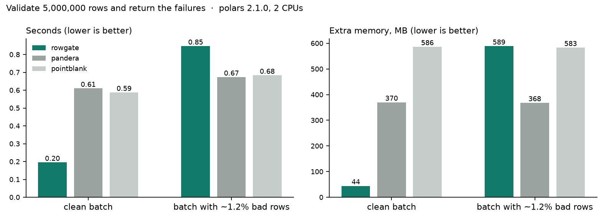

# Benchmark

rowgate, Pandera and Pointblank are all good tools, and they answer slightly different questions. This benchmark gives all three the same job, the one rowgate is built for: **validate a batch and hand back the rows that failed.**



## Results

Median of 5 runs. Memory is the peak resident memory above the level before validation started. Each library runs in its own fresh process.

### Clean batch (no bad rows)

| Rows | rowgate | Pandera | Pointblank |
|---:|---:|---:|---:|
| 100,000 | **0.008 s**, 4 MB | 0.014 s, 6 MB | 0.024 s, 13 MB |
| 1,000,000 | **0.042 s**, 13 MB | 0.127 s, 99 MB | 0.134 s, 161 MB |
| 5,000,000 | **0.195 s**, 44 MB | 0.610 s, 370 MB | 0.587 s, 586 MB |

### Batch with about 1.2% bad rows

| Rows | rowgate | Pandera | Pointblank |
|---:|---:|---:|---:|
| 100,000 | **0.021 s**, 16 MB | 0.024 s, 8 MB | 0.027 s, 14 MB |
| 1,000,000 | 0.182 s, 193 MB | 0.145 s, 104 MB | **0.142 s**, 162 MB |
| 5,000,000 | 0.847 s, 589 MB | **0.673 s**, 368 MB | 0.683 s, 586 MB |

## How to read this

**Most batches are clean, and that's where rowgate is fastest.** On a clean batch rowgate is about 3 times faster and uses 8 to 13 times less memory. It checks every rule in one lazy pass and stops there when nothing fails.

**On a dirty batch rowgate is about 25% slower, because it hands back more.** rowgate returns two complete tables: every valid row, ready to load, and every bad row with all of its failure reasons. Building the valid table means copying the data, so the memory cost is about the size of the batch.

**The three libraries return different things.** Per 100,000 dirty rows:

| Library | What comes back | Count |
|---|---|---:|
| rowgate | Bad rows, each with every reason it failed | 1,183 rows |
| Pandera | Individual failing values (a row can appear more than once, and both copies of a duplicate key are counted) | 1,389 values |
| Pointblank | Failing rows from `get_sundered_data("fail")`, which skips the uniqueness step | 982 rows |

rowgate's 1,183 matches an independent count of the bad rows exactly. Pointblank's export misses about 200 rows with duplicate keys because `rows_distinct` isn't included in the sundered data. That's a difference in what the export covers rather than a bug, but it matters if you load the "pass" half.

## Method

- **Data.** Synthetic orders with `order_id`, `customer`, `amount`, `status` and `sku`. The dirty set mixes nulls, duplicate keys, out-of-range amounts, unknown statuses and malformed SKUs.
- **Rules.** The same in every library: `order_id` not null and unique, `customer` not null, `amount` between 0 and 10,000, `status` in a set of 4 values, `sku` matches `^[A-Z]{3}-\d{4}$`. Nulls pass the range, set and pattern checks, as in SQL.
- **Machine.** 2 CPUs, 7 GB RAM, x86_64 Linux, Python 3.14.8.
- **Versions.** rowgate 0.2.0, Polars 2.1.0, Pandera 0.36.0, Pointblank 1.3.0.

## Run it yourself

```bash
pip install rowgate "pandera[polars]" pointblank numpy psutil
python benchmarks/bench.py --rows 100000 1000000 5000000
python benchmarks/chart.py
```

The raw numbers are in [`benchmarks/results.json`](https://github.com/DTheDataGuy/rowgate/blob/main/benchmarks/results.json). If you think a library is being used unfairly, please [open an issue](https://github.com/DTheDataGuy/rowgate/issues). The point is to be accurate, not to win.
