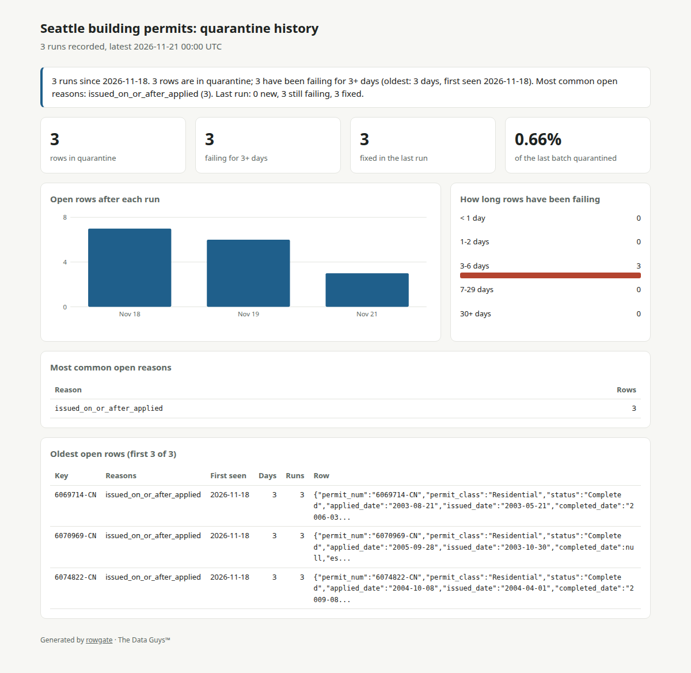

# Track failures across runs

A single run tells you what failed today. History tells you what has been failing **for days**, which is the question that actually gets data fixed.

```bash
rowgate check orders.parquet --contract orders.toml --history quality/orders
rowgate history quality/orders --html quality/orders.html
```

```python
store = rg.QuarantineStore("quality/orders")
rg.validate(df, contract, history=store)

store.summary()        # a few sentences for a log or a chat message
store.open_issues()    # one row per open issue, with days_open and times_seen
store.aging()          # open rows bucketed: < 1 day, 1-2, 3-6, 7-29, 30+
store.runs()           # one row per run: new, still failing, fixed, open after
```

## The dashboard

`rowgate history DIR --html page.html` writes one self-contained HTML file with the trend of open rows, how long rows have been failing, the most common reasons and the oldest open rows. Attach it to a CI run or publish it with GitHub Pages.



[Open the live example](../assets/history-demo.html), built from three days of the Seattle permits pipeline in [`examples/quarantine_history.py`](https://github.com/DTheDataGuy/rowgate/blob/main/examples/quarantine_history.py).

## Storage

The store is a folder: `runs.parquet`, `issues.parquet`, and `quarantine/<run_id>.parquet` with the full rows of each run. It's plain Parquet, so you can query it with Polars, DuckDB or your warehouse. Put it on a shared disk, commit it, or cache it between CI runs. It expects one writer at a time, which is how scheduled pipelines run.
